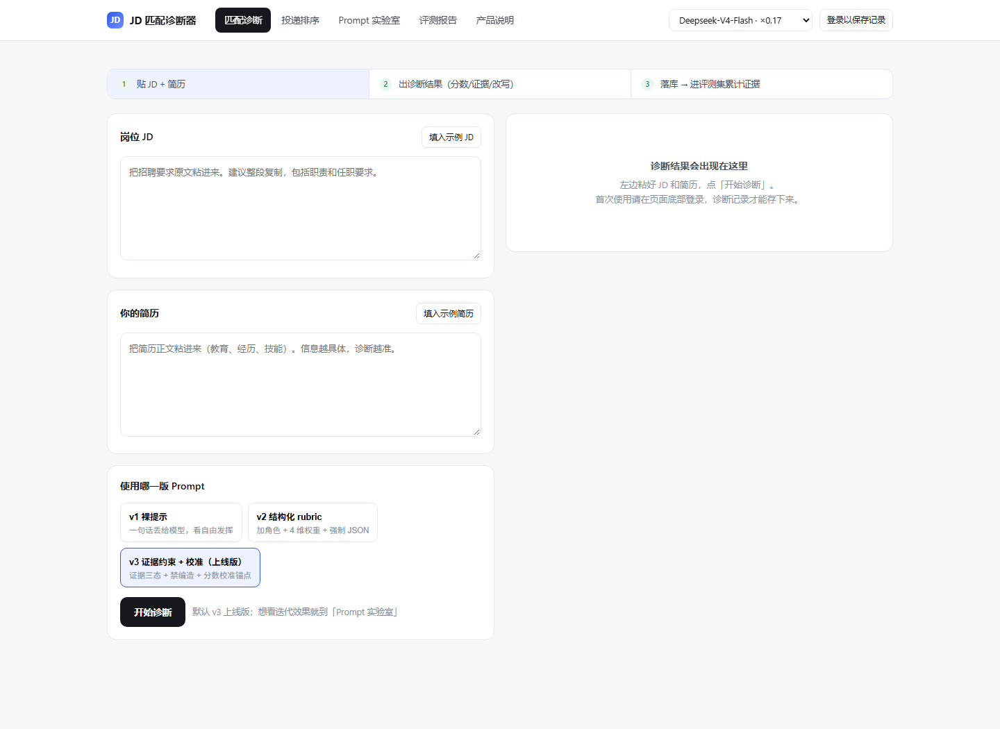
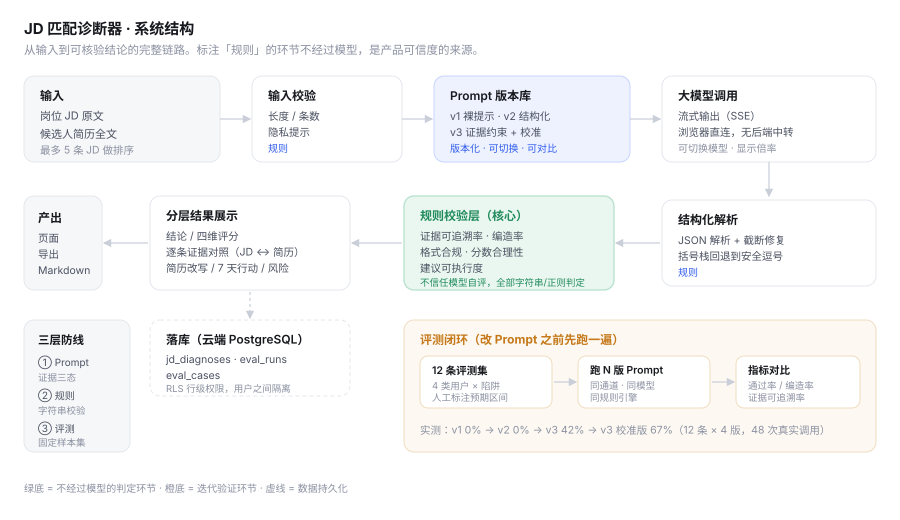

# JD 匹配诊断器

> **一句话（给非技术面试官）**：把岗位要求和简历一起贴进去，它逐条告诉你——这条要求你满足了没有、依据是哪句原文、还差什么、接下来 7 天该补什么。


把「我的简历和这条 JD 差在哪」从一句感觉，变成一份**带证据、可追溯、可复现**的诊断。

**线上地址：** https://jd-match-analyzer.app.workbuddy.host/



---

## 30 秒看懂

- **是什么**：一个真实可用的网页产品。粘贴 JD + 简历，输出四维加权评分、逐条证据标注、可执行的行动建议，支持一键导出 Markdown 报告。
- **核心难点**：AI 评简历最容易犯的错是**编造**——模型会替候选人"脑补"出简历里没有的能力。本项目用"证据三态"机制把编造率压到 1%，并用一套规则评测引擎证明这一点。
- **为什么值得看**：这个项目不只交付了一个产品，还交付了**评测**。4 版 Prompt × 12 条分层样本 × 48 次真实调用的完整实验数据都在仓库里，结论从数据里来，不从感觉里来。

## 系统架构



绿色部分是不依赖模型的规则校验层——这是整个产品可信度的基础：模型输出必须通过证据检索、编造检测、格式校验、分数合理性四道关，才能呈现给用户。

## 产品能力

| 能力 | 说明 |
|---|---|
| 结构化诊断 | JD + 简历 → 4 维加权评分（技能 35 / 经历 30 / 业务 20 / 信号 15），权重写死在 Prompt 里保证可复现 |
| 证据三态 | 每条 JD 要求标注「命中 / 缺失 / 存疑」，命中必须逐字引用简历原文 |
| 反编造约束 | 声称命中但原文检索不到的，自动判为编造并计入指标 |
| 简历改写 | 给出可直接替换原句的改写句，而不是"建议补充项目经验" |
| 7 天行动 | 建议必须带具体工具名或交付物，否则不计为合格建议 |
| 投递排序 | 一份简历 + 最多 5 条 JD，先粗筛"先投哪个"，再对 Top 2 深挖 |
| Prompt 实验室 | 同一输入对比 v1/v2/v3 三版 Prompt 的输出差异，产品即实验记录 |
| 报告导出 | 一键导出 Markdown 诊断报告，可直接发人或存档 |
| 落库与复盘 | 每次诊断入库（云端 PostgreSQL + 行级权限），可回看历史、重新导出 |

**为什么分两层（轻诊断 + 重诊断）**：用户一天刷 30 个岗，每条都跑完整诊断又贵又慢。先用一次轻量调用粗筛（十几秒），只对 Top 2 跑完整诊断。用低成本动作做筛选，用高成本动作做深挖——这是所有 AI 产品都要面对的成本结构问题。

## 实测数据（12 样本 × 4 版 Prompt，48 次真实调用）

模型固定 `deepseek-v4-flash`，所有指标由 `judge.js` 规则引擎计算，**不让模型自评**。评测集按「用户类型 × 难度 × 陷阱」分层：高匹配基线、跨行迁移、过度包装、信息不足、严重错配。

| 版本 | 通过率 | 证据可追溯 | 编造率 | 格式合规 | 分数合理 | 建议可执行 |
|---|---|---|---|---|---|---|
| v1 裸提示 | 0% | 0% | — | — | 0% | 0% |
| v2 结构化 rubric | 0% | 0% | — | 58% | 29% | 0% |
| v3 仅证据约束 | 42% | 81% | 1% | 93% | 50% | 65% |
| **v3 校准版（上线）** | **67%** | 84% | 1% | 93% | 67% | 70% |

三个最有价值的结论：

1. **加 JSON schema 救不了 Prompt。** v2 加了 schema、加了 4 维权重，通过率仍是 0%——因为它只约束格式，不约束"不许编"。v3 加入证据三态后，格式合规从 58% 跳到 93%。
2. **"不许吹牛"有副作用：不敢说话。** v3 第一版编造率压到 1%，但把最接近岗位的两个候选人压到 26 分和 39 分（人工标注应为 52 和 65）。加入校准锚点后偏差收敛（最差一条 -26 → -1），**而编造率没有反弹（1% → 1%）**。
3. **评测能发现工程 bug，不只是 Prompt 问题。** 有一样本的输出其实是正确判断（52 分，正好落在预期区间），但流被截断后 JSON 解析失败，整条被判错。修法是括号栈截断修复——如果不逐条看原始输出，会误判成"Prompt 判断不准"，然后改错方向。

完整方法论、逐条偏差分析、以及两处**人工标注争议的诚实记录**（存在标注比模型更乐观的样本，未为通过率好看而改标注），见 [`docs/测试报告.md`](docs/测试报告.md)，原始数据见 `docs/eval-*.json`。

## 关键设计决策

**1. 不让模型自由给分。** 4 维权重写死在 Prompt 里，模型只负责在每维里找证据。分数因此可复现、可解释、可跨版本比较。

**2. 不信任模型的自评。** 评测的 5 项指标（证据可追溯率、编造率、格式合规率、分数合理性、建议可执行度）全部由规则引擎计算。否则整个评测就成了"用感觉验证感觉"。

**3. 信息不足时明确说不知道。** 评测集中有一条几乎空白的简历。宁可给 20 分并提示"无法判断"，也不能编造经历凑到 60 分——后者会让用户带着错误的自信去投递。

**4. 评测集必须埋陷阱。** 只测"正常简历"会得出虚假的高通过率。跨行迁移、过度包装、信息不足、严重错配这些边界样本，才是产品真实会遇到的世界。

## 目录结构

```
index.html                  单文件页面（无构建步骤，打开即用）
assets/prompts.js           4 版 Prompt（v1/v2/v3 + 轻诊断扫描版，含输出 schema）
assets/evalset.js           12 条评测样本 + 3 类真实 JD（名字已脱敏）
assets/judge.js             规则评测引擎（5 项客观指标 + 截断 JSON 修复）
assets/app.js               业务逻辑：调用 / 解析 / 渲染 / 落库 / 评测调度 / 登录
assets/vendor/              内置的云端 SDK（不依赖外网 CDN，国内可用）
tools/run-eval.mjs          复现评测：全矩阵（3 版 × 12 样本）
tools/run-v3.mjs            复现评测：单版本重跑（校准验证用）
tools/summarize.cjs         汇总两次结果，打印对比表
docs/测试报告.md            完整评测报告
docs/eval-*.json            原始评测数据（逐样本明细）
docs/architecture.svg       系统架构图
```

## 本地运行与复现

产品：直接用浏览器打开 `index.html`（或访问线上地址），首次使用需登录（验证码 / WorkBuddy 账号）。

复现评测（需要 Node 18+）：

```bash
node tools/run-eval.mjs      # 全矩阵评测，约 5-10 分钟
node tools/run-v3.mjs        # v3 单版本重跑
node tools/summarize.cjs     # 打印对比表
```

## 已知局限

1. **无法验证经历真伪**：只能判断"简历里有没有证据"，判断不了"经历是不是真的"
2. **分数不是绝对值**：65 分不是"你这个人 65 分"，是"在这条 JD 口径下证据覆盖度是 65"
3. **评测集只有 12 条**：样本小，只能发现明显退化，做不了显著性检验
4. **未做真实用户规模验证**：这是最需要补的一块
5. **单一模型验证**：同一 Prompt 换模型效果会有波动，目前只测过一个

主动说局限，比被问出来强。

## Roadmap

- [ ] 评测集扩到 100 条，人工双标，计算标注一致性
- [ ] "同一份简历 × 多个 JD"横向对比，帮用户选投递优先级
- [ ] 诊断结果生成可分享的只读链接（增长入口）
- [ ] 项目 02：面试模拟 Agent（多轮 + 工具调用 + 任务完成率评测）

## License

[MIT](LICENSE)
