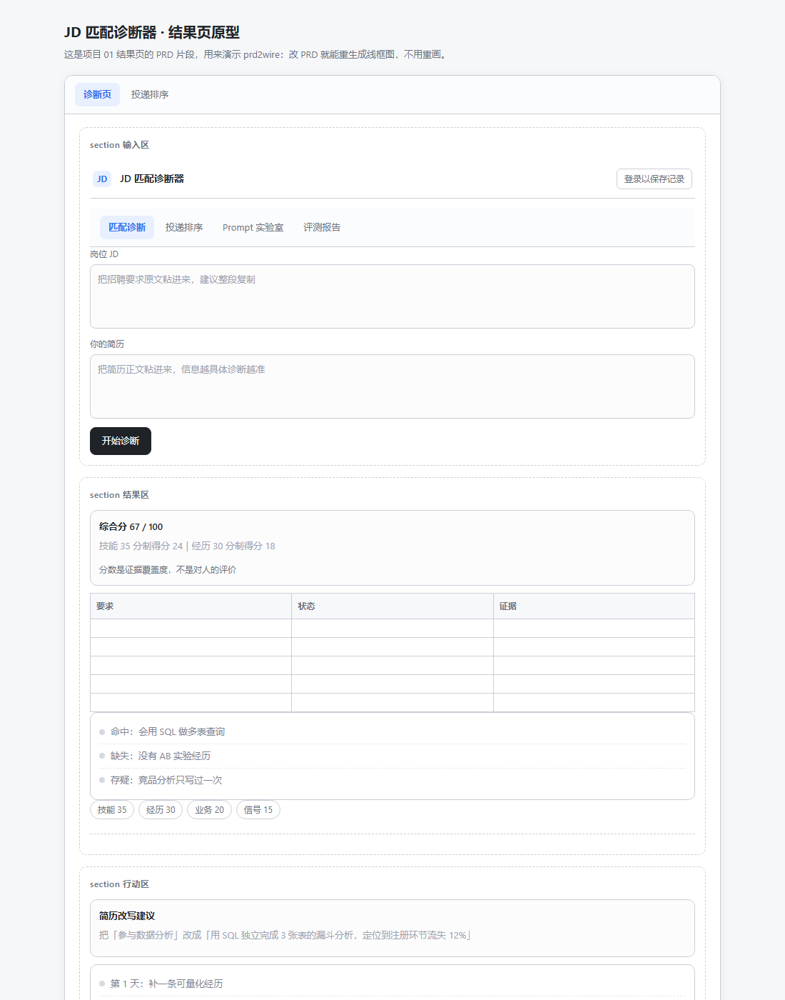

# 04 · PRD 转线框图与提示词迭代

> 一句话：需求文档改一句，跑一条命令，页面草图跟着更新。


改需求不用重画原型：把结构化 PRD 直接生成可交互的 HTML 线框图。



## 为什么做这个

写 PRD 最痛的不是写，是改——每次改需求都要同步改原型图。这个工具把"原型"降级为 PRD 的**渲染产物**：PRD 是唯一事实源，改完重跑一次命令即可。

## 用法

```bash
node prd2wire.mjs examples/prd-jd-matcher.md out.html
```

PRD 语法刻意保持极简（非设计师也能改）：

```markdown
# 页面原型名
> 一句话说明
## page 页面名
### section 区块名
- navbar: logo=JD, title=JD 匹配诊断器, right=登录
- textarea: label=岗位 JD, rows=5
- button: text=开始诊断, style=primary
```

支持 14 种组件：`navbar / tabs / textarea / input / select / button / card / list / table / chart / tags / divider / footer / note`。未知组件会被跳过并警告，不会让整个转换失败。

## 提示词迭代（3 版，每次只改一处）

配套的模型侧实验：让大模型把自由格式的 PRD 转成上述 DSL，同一任务写 3 版提示词对比。

| 版本 | 只改的一处 | 结果 |
|---|---|---|
| v1 | —（基线） | 组件名自造（如 `header`、`btn`），渲染器大量跳过 |
| v2 | 把 14 个组件名 + 每个组件的参数写进 Prompt | 组件名 100% 合法，但参数仍自由发挥（`rows=五六行`） |
| v3 | 追加 2 个完整 few-shot 示例（输入→期望 DSL） | 组件与参数全部合规，可稳定直出可渲染的 PRD |

结论：**对"输出必须严格符合 DSL"的任务，few-shot 的收益远大于规则描述**。v2 靠枚举解决了合法性，v3 靠示例解决了参数规范性。

## 边界（主动说明）

- 这是**低保真线框图**：灰度块表达结构与层级，不含视觉设计。定位是"改需求当天就能看到新结构"，不是替代 Figma。
- 解析器约 200 行、零依赖，组件渲染全部确定性代码——这条链路里没有模型，所以结果 100% 可复现。
